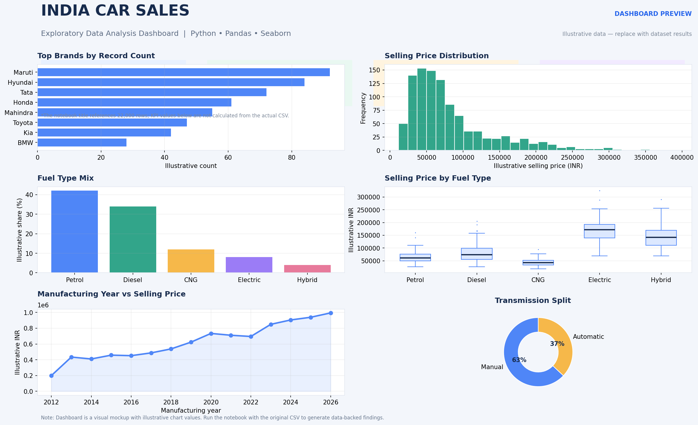

# India Car Sales Analysis

Exploratory data analysis (EDA) of Indian car sales data using Python, Pandas, NumPy, Matplotlib, and Seaborn.

## Dashboard Preview



> The dashboard image is a visual mockup with illustrative chart values because the CSV dataset was not included with the uploaded notebook. Run the notebook against the original dataset for real results.

## Project Contents
- `notebooks/Car_Sales_Analysis.ipynb` — analysis notebook
- `visualizations/car_sales_dashboard.png` — dashboard preview image
- `data/README.md` — where to place the dataset
- `requirements.txt` — Python dependencies

## Topics Covered
- Dataset inspection, missing values, data types, and summary statistics
- Univariate, bivariate, and multivariate analysis
- Brand counts and selling-price distributions
- Fuel type, transmission, mileage, city, engine capacity, and manufacturing year comparisons
- Correlation heatmaps
- Feature engineering: car age, selling price in lakhs, and mileage categories
- Business questions about popular brands, brand pricing, cities, fuel types, and age-price correlation

## Dataset Setup
Place your CSV file named `india_car_sales_22000_rows.csv` inside the `data/` folder.

The notebook loads the CSV from `../data/india_car_sales_22000_rows.csv`. If your dataset has a different name, update the path in the first data-loading cell.

## Run the Notebook
```bash
pip install -r requirements.txt
jupyter notebook
```
Open `notebooks/Car_Sales_Analysis.ipynb` and run cells from top to bottom.
## Libraries
Python, Pandas, NumPy, Matplotlib, Seaborn, Jupyter Notebook.
